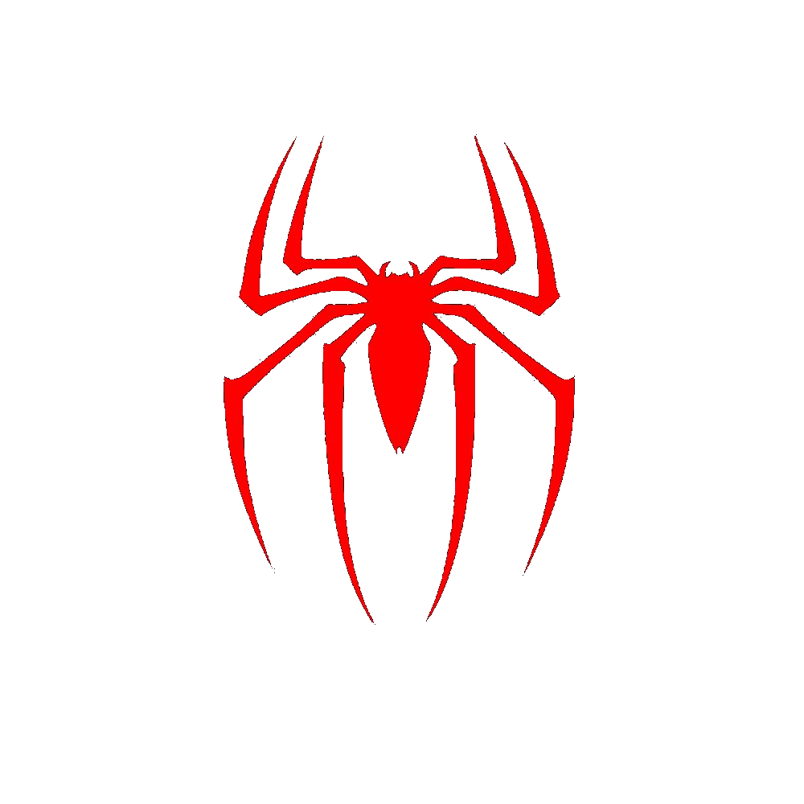

# 🕷️ Spider-Man: Brand New Day

Welcome to the official promotional website for **Spider-Man: Brand New Day** — swinging into cinemas on **July 31, 2026**! 🕸️



## 🎬 About the Project

This is a modern, high-performance web application built to showcase the upcoming Spider-Man movie. Designed with slick animations, stunning visuals, and an immersive user experience fit for your friendly neighborhood web-slinger.

## 🚀 Technologies Used

- **Framework:** [Next.js](https://nextjs.org/) (React)
- **Styling:** Tailwind CSS
- **Animations:** Framer Motion & GSAP
- **Deployment:** Vercel

## 🛠️ Getting Started

To run this project locally, simply follow these steps:

1. **Install dependencies:**
   ```bash
   npm install
   ```

2. **Start the development server:**
   ```bash
   npm run dev
   ```

3. **Open the app:**
   Navigate to [http://localhost:3000](http://localhost:3000) in your browser.

## 🕸️ Contributing

Contributions are always welcome! Feel free to open issues or submit pull requests if you want to help make this project even better.

---

*With great power, comes great responsibility.* 🏙️
